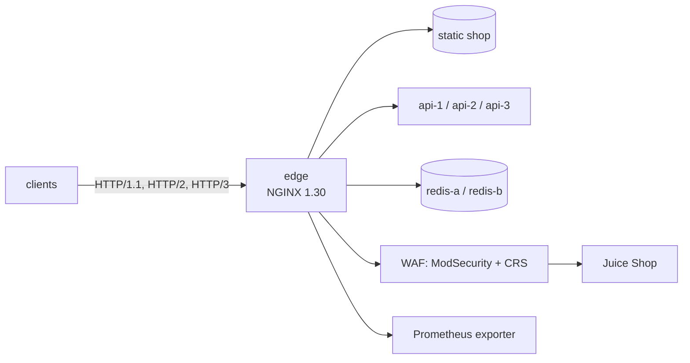

# NGINX in Practice – Hands-on Labs


Eleven labs that turn a bare NGINX container into the production-ready edge of **PixelShop**, a fictional online shop. Every lab builds on the previous one – same environment, same story, real tools.



## Labs

| # | Lab | You will… | Time |
|---|---|---|---|
| 01 | [Virtual hosts & locations](labs/LAB01-virtual-hosts/README.md) | start the environment, host two sites, master location matching | 35 min |
| 02 | [Reverse proxy](labs/LAB02-reverse-proxy/README.md) | proxy an API, forward client details, handle timeouts, proxy WebSockets | 35 min |
| 03 | [Load balancing](labs/LAB03-load-balancing/README.md) | balance 3 instances, survive a crash, sticky routing, re-resolve DNS | 40 min |
| 04 | [Caching & compression](labs/LAB04-caching-compression/README.md) | gzip, browser caching, proxy cache with stale-on-error | 40 min |
| 05 | [TLS, HTTP/2 & HTTP/3](labs/LAB05-tls-http3/README.md) | modern TLS, redirects, QUIC, HSTS | 40 min |
| 06 | [Access control & rate limiting](labs/LAB06-access-control/README.md) | basic auth + IP rules, `auth_request`, rate limits, security headers | 45 min |
| 07 | [Logging & monitoring](labs/LAB07-logging-monitoring/README.md) | JSON logs, request IDs, Prometheus metrics, GoAccess dashboard | 40 min |
| 08 | [TCP/UDP with stream](labs/LAB08-stream-tcp-udp/README.md) | L4 load balancing and failover for Redis, UDP DNS proxy | 25 min |
| 09 | [Modules & njs](labs/LAB09-modules-njs/README.md) | JavaScript at the edge, build a dynamic module for the exact NGINX version | 40 min |
| 10 | [WAF: attack & defend](labs/LAB10-waf/README.md) | SQLi/XSS against Juice Shop, ModSecurity v3 + OWASP CRS, tuning | 45 min |
| 11 | [Break-fix challenge](labs/LAB11-break-fix/README.md) | fix 8 broken production configs, scored automatically | 40 min |

## Prerequisites

- Linux VM (Ubuntu 24.04 recommended), 2 vCPU, 4 GB RAM, 15 GB disk
- Docker Engine with the Compose plugin (`docker compose version`), user in the `docker` group
- `curl`, `jq`, `openssl`, `git` – `sudo apt install -y curl jq openssl git dnsutils`
- Free ports on the VM: 80, 443 (TCP+UDP), 8080, 6379, 5353/udp, 9113
- Comfortable with the Linux shell and basic HTTP

Host names use `*.localtest.me` (public DNS → `127.0.0.1`). Working from your laptop against a remote VM? Use an SSH tunnel or replace the names with `<name>.<VM-IP>.nip.io`.

## Quick start

```bash
git clone <this repository> nginx-labs && cd nginx-labs
chmod +x bin/*
./bin/ngx up
curl -i http://localtest.me/
```

## The `ngx` helper

| Command | What it does |
|---|---|
| `./bin/ngx up` / `down` / `ps` | start / stop / list the environment |
| `./bin/ngx test` | `nginx -t` |
| `./bin/ngx reload` | `nginx -t` and graceful reload |
| `./bin/ngx dump` | `nginx -T` – the full effective configuration |
| `./bin/ngx logs [name]` | follow `env/logs/<name>.log` |
| `./bin/ngx certs` | create the local CA and `*.localtest.me` certificate |
| `./bin/ngx catchup <N>` | **fell behind?** load the solution of lab N (your files are backed up) |
| `./bin/ngx breakfix` / `check` | LAB11 challenge |

## Repository layout

```
env/                    everything the containers use
  docker-compose.yml
  nginx/nginx.conf      main config (do not edit)
  nginx/conf.d/         http-level config - this is where you work
  nginx/snippets/       reusable include files
  nginx/stream.d/       stream (TCP/UDP) config - LAB08
  nginx/modules-enabled load_module lines - LAB09
  nginx/njs/            JavaScript for njs - LAB09
  www/                  static content
  logs/                 NGINX logs (mounted)
labs/                   lab instructions
solutions/LABnn/        state of the config after each lab
break-fix/              LAB11 broken configs
bin/                    helper scripts
```

All solutions are validated with `nginx -t` against NGINX 1.30.

## License

MIT – see [LICENSE](LICENSE).
