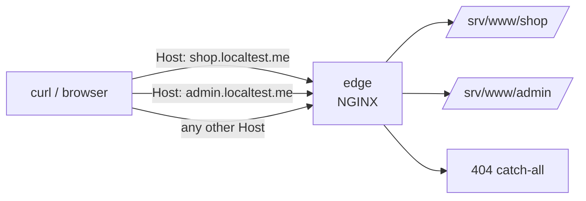

# LAB 01 – Environment, virtual hosts & location matching

> **Story:** You just joined *PixelShop*, a small online shop selling retro gadgets. Your first job as the new platform engineer: put the shop and the admin panel behind one NGINX "edge" server.

| | |
|---|---|
| **Duration** | ~35 min |
| **You edit** | `env/nginx/conf.d/10-shop.conf`, `env/nginx/conf.d/20-admin.conf` |
| **Solution** | `solutions/LAB01/` (or `./bin/ngx catchup 1`) |



## Part A – Start the environment

1. Prerequisites: Linux VM with Docker Engine + Compose plugin (`docker compose version`), ports 80/443/8080 free.
2. Start everything and check the containers:

   ```bash
   cd nginx-labs        # the folder you cloned the repository into
   chmod +x bin/*
   ./bin/ngx up
   ./bin/ngx ps
   ```

3. `*.localtest.me` is a public DNS name that always resolves to `127.0.0.1` – no `/etc/hosts` editing needed.

   ```bash
   curl -i http://localtest.me/
   ```

   ✅ **Checkpoint:** `HTTP/1.1 404` with the body `PixelShop edge: no site configured for host 'localtest.me'`.

> 💡 No internet DNS in your classroom? Add the names with **`tee -a`** (append!): `echo "127.0.0.1 shop.localtest.me admin.localtest.me api.localtest.me" | sudo tee -a /etc/hosts`

Get to know the helper – you will use it all the time:

```bash
./bin/ngx test     # nginx -t
./bin/ngx reload   # nginx -t && nginx -s reload (no downtime)
./bin/ngx dump     # nginx -T: the whole effective config, includes resolved
```

## Part B – Two websites, one server

1. Create `env/nginx/conf.d/10-shop.conf`:

   ```nginx
   server {
       listen 80;
       server_name shop.localtest.me;

       root  /srv/www/shop;
       index index.html;

       location / {
           try_files $uri $uri/ =404;
       }
   }
   ```

2. Create `env/nginx/conf.d/20-admin.conf` the same way for `admin.localtest.me` with `root /srv/www/admin;`.
3. Reload and test:

   ```bash
   ./bin/ngx reload
   curl -s http://shop.localtest.me/  | grep '<title>'
   curl -s http://admin.localtest.me/ | grep '<title>'
   curl -s -H "Host: admin.localtest.me" http://127.0.0.1/ | grep '<title>'
   ```

   ✅ **Checkpoint:** `PixelShop - retro gadgets`, `PixelShop admin`, and `PixelShop admin` again – NGINX picks the server **only by the `Host` header**, not by IP.

4. What happens for an unknown name? `curl -i http://nobody.localtest.me/` → the `default_server` in `00-default.conf` answers. Open that file and explain why.

## Part C – Which location wins?

Add these blocks to the **shop** server. The `X-Location` header shows which block handled the request:

```nginx
    location / {
        add_header X-Location "prefix /" always;
        try_files $uri $uri/ =404;
    }

    location = /health {
        access_log off;
        default_type text/plain;
        return 200 "shop OK\n";
    }

    location ^~ /assets/ {
        add_header X-Location "prefix ^~ /assets/" always;
    }

    location ~* \.(png|jpe?g|gif|svg|ico)$ {
        add_header X-Location "regex images" always;
    }

    location /docs/ {
        alias /srv/www/docs/;
        add_header X-Location "prefix /docs/ (alias)" always;
    }
```

**Before you test – predict!** Fill in the table, then verify with `curl -sI http://shop.localtest.me<URI> | grep -i x-location`.

| URI | Your prediction | Result |
|---|---|---|
| `/health` | | |
| `/assets/logo.svg` | | |
| `/img/logo.svg` | | |
| `/docs/` | | |
| `/index.html` | | |

<details><summary>Explanation</summary>

1. Exact match `=` wins immediately (`/health` – no header, it just returns).
2. Otherwise the **longest prefix** is remembered; if it has `^~`, regexes are skipped (`/assets/logo.svg` → `^~ /assets/`).
3. Regexes are checked **in file order**; first match wins (`/img/logo.svg` → `regex images`).
4. No regex matched → the remembered longest prefix is used (`/docs/`, `/index.html` → `prefix /`).
</details>

## Part D – Custom error page

```nginx
    error_page 404 /404.html;
    location = /404.html {
        internal;
    }
```

✅ **Checkpoint:** `curl -i http://shop.localtest.me/nope` returns 404 with the PixelShop page; `curl -i http://shop.localtest.me/404.html` is also a 404 (`internal`).

## Bonus

- Redirect `www.shop.localtest.me` to `shop.localtest.me` with a separate server block and `return 301`.
- Break `alias` on purpose: remove the trailing `/` from `alias /srv/www/docs/;` – what does `/docs/index.html` map to now? (Hint: the error log in `env/logs/error.log`.)
- Run `./bin/ngx dump | less` and find your server blocks in the effective configuration.

## Troubleshooting

| Symptom | Likely cause |
|---|---|
| `nginx: [emerg] unexpected "}"` | missing `;` on the line above |
| 403 Forbidden on `/` | no `index.html` and no `autoindex` |
| changes are ignored | you forgot `./bin/ngx reload` – or the file does not end in `.conf` |
| `conflicting server name` warning | the same `server_name` + port is defined twice |
