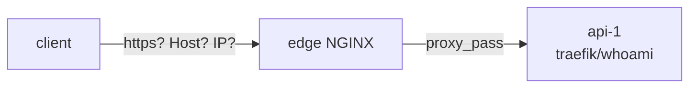

# LAB 02 – Reverse proxy, headers & WebSockets

> **Story:** The developers deployed the PixelShop API (`api-1`). It must be reachable at `api.localtest.me` – and it must see who the real client is.

| | |
|---|---|
| **Duration** | ~35 min |
| **You edit** | `conf.d/30-api.conf`, `conf.d/00-maps.conf`, `snippets/proxy-headers.conf` |
| **Solution** | `solutions/LAB02/` (or `./bin/ngx catchup 2`) |



The backend is `traefik/whoami`: it prints the request exactly as it received it – perfect to *see* what the proxy does.

## Step 1 – A naive proxy

`env/nginx/conf.d/30-api.conf`:

```nginx
server {
    listen 80;
    server_name api.localtest.me;

    location / {
        proxy_pass http://api-1:80;
    }
}
```

```bash
./bin/ngx reload
curl -s http://api.localtest.me/hello
```

Look at the output: `Host: api-1` and `RemoteAddr` is the edge container. **The app has no idea about the real host name or client IP.** That breaks redirects, absolute links, logging and rate limiting in the app.

## Step 2 – Forward the original request details

Create a reusable snippet `env/nginx/snippets/proxy-headers.conf`:

```nginx
proxy_set_header Host              $host;
proxy_set_header X-Real-IP         $remote_addr;
proxy_set_header X-Forwarded-For   $proxy_add_x_forwarded_for;
proxy_set_header X-Forwarded-Proto $scheme;
proxy_set_header X-Forwarded-Host  $host;
```

Add `include /etc/nginx/snippets/proxy-headers.conf;` inside the location and reload.

✅ **Checkpoint:** `curl -s http://api.localtest.me/hello` shows `Host: api.localtest.me`, `X-Real-Ip`, `X-Forwarded-For` and `X-Forwarded-Proto: http`.

> ⚠️ `proxy_set_header` follows the same rule as `add_header`: a level that defines **any** `proxy_set_header` inherits **none** from the level above. That's why we use a snippet.

## Step 3 – The trailing slash in `proxy_pass`

```nginx
    location /v1/ {
        proxy_pass http://api-1:80/;     # note the "/" at the end
        include /etc/nginx/snippets/proxy-headers.conf;
    }
```

Compare the request line printed by whoami:

```bash
curl -s http://api.localtest.me/v1/users | head -n 4
```

✅ **Checkpoint:** the backend receives `GET /users` – the matched prefix `/v1/` was replaced by `/`. Remove the trailing slash, reload, and the backend gets `GET /v1/users`.

## Step 4 – Timeouts and a friendly error

whoami can be slowed down with `?wait=`. Add to the **server** block:

```nginx
    proxy_connect_timeout 2s;
    proxy_read_timeout    3s;

    error_page 502 504 = @api_down;
    location @api_down {
        default_type application/json;
        return 503 '{"error":"api temporarily unavailable","request_id":"$request_id"}\n';
    }
```

```bash
curl -i "http://api.localtest.me/?wait=1s"    # 200
curl -i "http://api.localtest.me/?wait=5s"    # after 3 s
```

✅ **Checkpoint:** the slow request returns `503` with the JSON body instead of a bare `504 Gateway Time-out`. Check `env/logs/error.log` for `upstream timed out`.

## Step 5 – WebSockets

WebSockets start as HTTP/1.1 with `Upgrade: websocket`. These headers are *hop-by-hop*, so NGINX does **not** forward them unless told to.

1. `env/nginx/conf.d/00-maps.conf` (http level):

   ```nginx
   map $http_upgrade $connection_upgrade {
       default upgrade;
       ''      close;
   }
   ```

2. In the api server:

   ```nginx
       location /echo {
           proxy_pass http://api-1:80;
           include /etc/nginx/snippets/proxy-headers.conf;
           proxy_http_version 1.1;
           proxy_set_header Upgrade    $http_upgrade;
           proxy_set_header Connection $connection_upgrade;
           proxy_read_timeout 1h;
       }
   ```

3. Test the handshake (Ctrl+C to exit):

   ```bash
   curl -i -N --http1.1 \
     -H "Connection: Upgrade" -H "Upgrade: websocket" \
     -H "Sec-WebSocket-Version: 13" -H "Sec-WebSocket-Key: dGhlIHNhbXBsZSBub25jZQ==" \
     http://api.localtest.me/echo
   ```

✅ **Checkpoint:** `HTTP/1.1 101 Switching Protocols`. Comment out the two `Upgrade`/`Connection` lines, reload, and see it fail.

Optional – real messages: `docker run --rm -it --network host ghcr.io/vi/websocat ws://api.localtest.me/echo`

## Bonus

- Hide a backend header from clients: `proxy_hide_header X-Powered-By;` (whoami doesn't send it – try with `add_header` on a test server).
- Server-Sent Events / streaming APIs: why would you use `proxy_buffering off;` there?
- What does `$proxy_add_x_forwarded_for` do when the client already sends `X-Forwarded-For: 1.2.3.4`? Try it.

## Troubleshooting

| Symptom | Likely cause |
|---|---|
| `host not found in upstream "api-1"` | the container is not running – `./bin/ngx ps` |
| backend sees `/v1/v1/...` or `/users` unexpectedly | trailing slash in `proxy_pass` |
| WebSocket returns 400 / 426 | missing `proxy_http_version 1.1` or the `Upgrade`/`Connection` headers |
