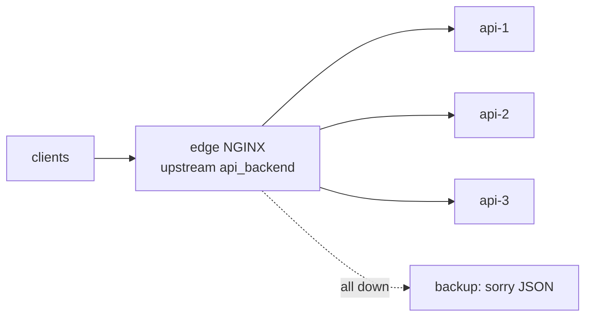

# LAB 03 – Load balancing, failover & sticky routing

> **Story:** Black Friday is coming. One API instance won't survive – the team scaled to three (`api-1`, `api-2`, `api-3`). Spread the traffic, survive a crashing instance, and keep each user on "their" instance when asked.

| | |
|---|---|
| **Duration** | ~40 min |
| **You edit** | `conf.d/00-upstreams.conf`, `conf.d/30-api.conf` |
| **Solution** | `solutions/LAB03/` (or `./bin/ngx catchup 3`) |



## Step 1 – Round robin

`env/nginx/conf.d/00-upstreams.conf`:

```nginx
upstream api_backend {
    zone api_backend 64k;
    server api-1:80;
    server api-2:80;
    server api-3:80;
    keepalive 16;
}
```

In `30-api.conf` change `location /` to:

```nginx
    location / {
        proxy_pass http://api_backend;
        include /etc/nginx/snippets/proxy-headers.conf;
        proxy_http_version 1.1;
        proxy_set_header Connection "";     # required for upstream keep-alive
    }
```

```bash
./bin/ngx reload
for i in $(seq 1 9); do curl -s http://api.localtest.me/ | grep Name; done
```

✅ **Checkpoint:** `api-1, api-2, api-3, api-1, …`

## Step 2 – Weights and methods

1. Give `api-1` three times more traffic: `server api-1:80 weight=3;`

   ```bash
   for i in $(seq 1 50); do curl -s http://api.localtest.me/ | grep Name; done | sort | uniq -c
   ```

   ✅ **Checkpoint:** roughly 30 / 10 / 10.

2. Remove the weight and add `least_conn;` at the top of the upstream. Discuss: when is least connections better than round robin? (long requests, WebSockets, uneven backends)

## Step 3 – Sticky routing with consistent hashing

Add a second upstream:

```nginx
upstream api_sticky {
    zone api_sticky 64k;
    hash $http_x_user consistent;
    server api-1:80;
    server api-2:80;
    server api-3:80;
}
```

and a location in the api server:

```nginx
    location /sticky/ {
        proxy_pass http://api_sticky;
        include /etc/nginx/snippets/proxy-headers.conf;
    }
```

```bash
for u in alice bob carol dave; do
  echo -n "$u -> "; curl -s -H "X-User: $u" http://api.localtest.me/sticky/ | grep Name
done
```

✅ **Checkpoint:** every user always lands on the same instance – repeat the loop to verify. (`ip_hash` would do the same per client IP; `consistent` = only ~1/N of users move when you add or remove a server.)

## Step 4 – Failover (passive health checks)

Open NGINX OSS has **passive** health checks: a server that fails is taken out for `fail_timeout`.

1. Update the servers in `api_backend`:

   ```nginx
       server api-1:80 max_fails=2 fail_timeout=10s;
       server api-2:80 max_fails=2 fail_timeout=10s;
       server api-3:80 max_fails=2 fail_timeout=10s;
   ```

   and in `location /`:

   ```nginx
       proxy_next_upstream error timeout http_502;
       proxy_next_upstream_timeout 10s;
   ```

   By default only idempotent requests (GET, HEAD, …) are retried – a POST is never sent twice. Don't cap `proxy_next_upstream_tries` below the number of servers, or the `backup` server from Step 6 is never reached.

2. Generate continuous traffic in a second terminal:

   ```bash
   while true; do curl -s -o /dev/null -w "%{http_code} " http://api.localtest.me/; sleep 0.2; done
   ```

3. Kill an instance: `docker compose -f env/docker-compose.yml stop api-2`

✅ **Checkpoint:** only `200`s – the failed attempt is retried on another instance. `env/logs/error.log` shows `connect() failed` / `upstream ... is down`.

4. Start it again: `docker compose -f env/docker-compose.yml start api-2`. Does api-2 get traffic again? 🤔 Probably **not** – Docker may give it a **new IP**, and NGINX resolved the names only once, at startup.

## Step 5 – Re-resolve names at runtime (`resolve`)

Since NGINX 1.27.3 the open source version can re-resolve upstream names. Add at the top of `00-upstreams.conf`:

```nginx
resolver 127.0.0.11 valid=10s ipv6=off;    # Docker's embedded DNS
```

and add `resolve` to each server: `server api-1:80 resolve max_fails=2 fail_timeout=10s;` (requires the `zone`).

Repeat Step 4 (stop → start api-2). ✅ **Checkpoint:** after ≤10 s api-2 is back in rotation – no reload needed.

## Step 6 – A "sorry" backup

```nginx
# in api_backend
    server 127.0.0.1:8081 backup;

# separate server, same file
server {
    listen 127.0.0.1:8081;
    default_type application/json;
    return 503 '{"error":"all api instances are down - please retry later"}\n';
}
```

Stop all three API containers, then `curl -i http://api.localtest.me/`. ✅ **Checkpoint:** `503` with the JSON message. Start them again.

## Step 7 – Load test

```bash
docker compose -f env/docker-compose.yml --profile tools run --rm hey \
  -n 3000 -c 50 -host api.localtest.me http://127.0.0.1/
```

While it runs, stop and start an API instance. Compare the status code distribution and latency histogram. Then try `least_conn` vs round robin.

## Bonus

- **Active health checks** (`health_check` directive) are an NGINX Plus feature. How would you get a similar effect with OSS? (Hint: orchestrator readiness probes + `resolve`, or a sidecar.)
- Why is `backup` not allowed together with `hash` / `ip_hash`?
- Put `random two least_conn;` in the upstream – what does "power of two choices" mean?

## Troubleshooting

| Symptom | Likely cause |
|---|---|
| `invalid parameter "resolve"` | upstream without `zone`, or nginx older than 1.27.3 |
| all requests go to one server | `hash` with an empty key (no `X-User` header) |
| 502 after restarting a container | stale IP – see Step 5 |
