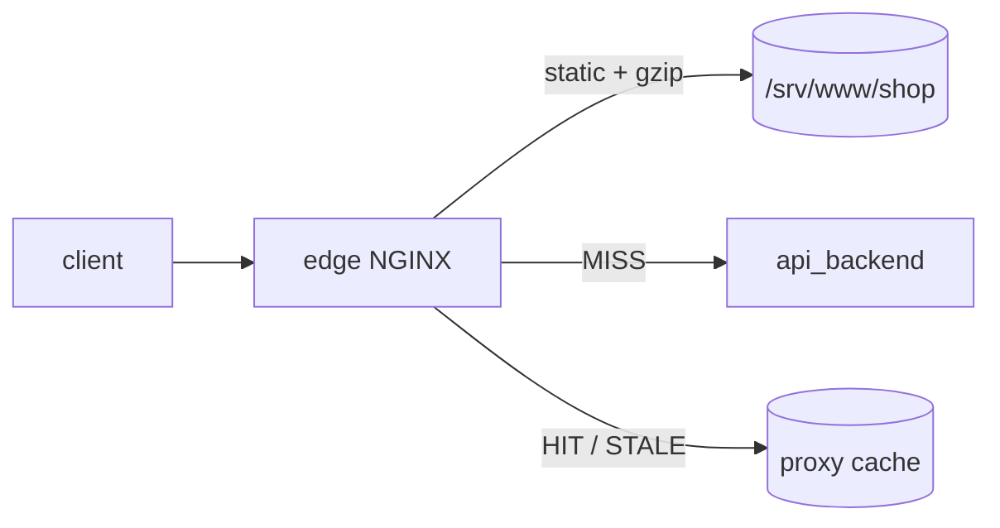

# LAB 04 – Static content, caching & compression

> **Story:** Marketing complains the shop is slow on mobile, and the catalog API melts under traffic although the catalog changes twice a day. Make the edge do the heavy lifting.

| | |
|---|---|
| **Duration** | ~40 min |
| **You edit** | `conf.d/05-compression.conf`, `conf.d/00-cache.conf`, `10-shop.conf`, `30-api.conf` |
| **Solution** | `solutions/LAB04/` (or `./bin/ngx catchup 4`) |



## Part A – Compression

1. Measure first:

   ```bash
   curl -s -o /dev/null -w "plain: %{size_download} bytes\n" http://shop.localtest.me/assets/app.js
   curl -s -o /dev/null -w "gzip : %{size_download} bytes\n" -H "Accept-Encoding: gzip" http://shop.localtest.me/assets/app.js
   ```

   Both the same? NGINX does not compress by default.

2. Create `env/nginx/conf.d/05-compression.conf` (http level):

   ```nginx
   gzip            on;
   gzip_comp_level 5;
   gzip_min_length 1024;
   gzip_vary       on;
   gzip_proxied    any;
   gzip_types      text/plain text/css application/javascript application/json
                   image/svg+xml application/xml;
   ```

   ✅ **Checkpoint:** repeat the measurement – the gzip version is ~90% smaller and the response has `Content-Encoding: gzip` and `Vary: Accept-Encoding`. (`text/html` is always compressed – do not list it.)

3. **Pre-compression** – compress once at build time instead of on every request:

   ```bash
   gzip -k -9 env/www/shop/assets/app.js env/www/shop/assets/app.css
   ```

## Part B – Browser caching for static assets

Replace the `/assets/` and image locations of the shop (you can drop the `X-Location` debug headers now):

```nginx
    location ^~ /assets/ {
        gzip_static on;                 # serve app.js.gz if it exists
        access_log  off;
        add_header Cache-Control "public, max-age=2592000, immutable" always;
    }

    location ~* \.(png|jpe?g|gif|svg|ico)$ {
        add_header Cache-Control "public, max-age=86400" always;
    }
```

✅ **Checkpoint:** `curl -sI -H "Accept-Encoding: gzip" http://shop.localtest.me/assets/app.js` shows `Cache-Control: public, max-age=2592000, immutable` and `Content-Encoding: gzip`. Run `curl -sI` twice – the `ETag` / `Last-Modified` stay the same.

> Why `immutable` is safe only for fingerprinted file names (`app.3f9a1c.js`) – discuss.

## Part C – Proxy cache for the API

1. Define the cache storage – `env/nginx/conf.d/00-cache.conf`:

   ```nginx
   proxy_cache_path /var/cache/nginx/edge/api levels=1:2 keys_zone=api_cache:10m
                    max_size=200m inactive=10m use_temp_path=off;
   ```

2. Add a cached location to the api server:

   ```nginx
       location /catalog/ {
           proxy_pass http://api_backend;
           include /etc/nginx/snippets/proxy-headers.conf;
           proxy_http_version 1.1;
           proxy_set_header Connection "";

           proxy_cache           api_cache;
           proxy_cache_key       $scheme$host$request_uri;
           proxy_cache_valid     200 30s;
           proxy_cache_valid     404 5s;
           proxy_cache_use_stale error timeout updating http_500 http_502 http_503 http_504;
           proxy_cache_background_update on;
           proxy_cache_lock      on;
           proxy_cache_bypass    $http_x_no_cache;
           proxy_no_cache        $http_x_no_cache;
           add_header X-Cache-Status $upstream_cache_status always;
       }
   ```

3. Watch the cache work:

   ```bash
   for i in 1 2 3 4; do curl -s -D - http://api.localtest.me/catalog/ -o /tmp/body | grep -i x-cache-status; grep Name /tmp/body; done
   ```

   ✅ **Checkpoint:** `MISS` then `HIT, HIT, HIT` – and always the **same** `Name`, although round robin is active. That's the cache answering.

   Repeating the lab later? The cache lives on a Docker volume and survives restarts, so the first answer may be `EXPIRED` or `STALE` (an old copy older than 30 s) instead of `MISS`. Use a new path such as `/catalog/2` to see a clean `MISS`.

4. Bypass: `curl -sI -H "X-No-Cache: 1" http://api.localtest.me/catalog/ | grep -i x-cache` → `BYPASS`.
5. **Cache as a safety net** – stop all API instances:

   ```bash
   docker compose -f env/docker-compose.yml stop api-1 api-2 api-3
   sleep 31
   curl -sI http://api.localtest.me/catalog/ | grep -i x-cache-status
   docker compose -f env/docker-compose.yml start api-1 api-2 api-3
   ```

   ✅ **Checkpoint:** `STALE` – the shop keeps working while the API is down.

6. Look inside: `docker compose -f env/docker-compose.yml exec edge find /var/cache/nginx/edge/api -type f | head`

## Bonus

- **Microcaching:** `proxy_cache_valid 200 1s;` on `/` and run `hey` with and without it. How many requests reach the backends?
- Why is `proxy_cache_key $uri` (seen in many online tutorials) dangerous? (two hosts, query strings…)
- Cache purge is a Plus feature – how would you invalidate the cache in OSS? (short TTL + background update, versioned URLs, or delete files on the volume)
- Brotli usually beats gzip by 15–20% – but needs the third-party `ngx_brotli` module. You will build modules in LAB09.

## Troubleshooting

| Symptom | Likely cause |
|---|---|
| always `MISS` | backend sends `Set-Cookie` / `Cache-Control: private`, or `proxy_cache_valid` missing |
| no `X-Cache-Status` header | `add_header` without `always` on error responses, or wrong location |
| `gzip_static` ignored | no `.gz` file next to the original, or the client sent no `Accept-Encoding: gzip` (remember to re-run `gzip -k` after every build – nginx does not compare timestamps) |
