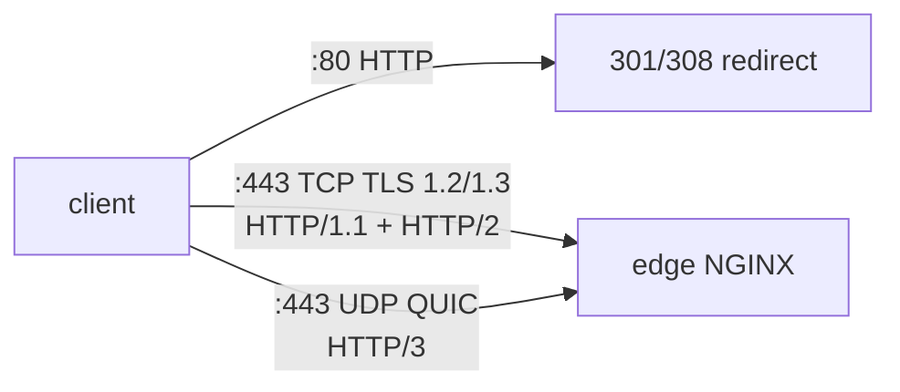

# LAB 05 – TLS, HTTP/2 & HTTP/3

> **Story:** The payment provider refuses to integrate with a shop served over plain HTTP. Move every PixelShop site to HTTPS with a modern TLS setup – and turn on HTTP/2 and HTTP/3 while you're at it.

| | |
|---|---|
| **Duration** | ~40 min |
| **You edit** | `conf.d/01-tls.conf`, `00-default.conf`, `10-shop.conf`, `20-admin.conf`, `30-api.conf` |
| **Solution** | `solutions/LAB05/` (or `./bin/ngx catchup 5`) |



## Step 1 – A certificate

In production you would use Let's Encrypt (certbot or the native NGINX ACME module – see the slides). In the lab we act as our own CA:

```bash
./bin/ngx certs
export CURL_CA_BUNDLE=$PWD/env/nginx/certs/ca.crt   # curl now trusts our CA
openssl x509 -in env/nginx/certs/localtest.me.crt -noout -subject -ext subjectAltName -enddate
```

## Step 2 – TLS defaults for all servers

`env/nginx/conf.d/01-tls.conf` (http level – every HTTPS server inherits it):

```nginx
ssl_certificate     /etc/nginx/certs/localtest.me.crt;
ssl_certificate_key /etc/nginx/certs/localtest.me.key;

ssl_protocols TLSv1.2 TLSv1.3;
ssl_ciphers ECDHE-ECDSA-AES128-GCM-SHA256:ECDHE-RSA-AES128-GCM-SHA256:ECDHE-ECDSA-AES256-GCM-SHA384:ECDHE-RSA-AES256-GCM-SHA384:ECDHE-ECDSA-CHACHA20-POLY1305:ECDHE-RSA-CHACHA20-POLY1305;
ssl_prefer_server_ciphers off;

ssl_session_cache   shared:TLS:10m;
ssl_session_timeout 1d;
ssl_session_tickets off;
```

(This is the Mozilla *intermediate* profile – check <https://ssl-config.mozilla.org> for the current version.)

## Step 3 – Shop on HTTPS with HTTP/2 and HTTP/3

Turn the existing shop server into an HTTPS server and add a redirect server:

```nginx
server {
    listen 80;
    server_name shop.localtest.me www.shop.localtest.me;
    return 301 https://shop.localtest.me$request_uri;
}

server {
    listen 443 ssl;
    listen 443 quic;               # HTTP/3 over UDP
    http2 on;                      # replaces the old "listen 443 ssl http2"
    server_name shop.localtest.me;

    add_header Alt-Svc 'h3=":443"; ma=86400' always;            # tell browsers HTTP/3 exists
    add_header Strict-Transport-Security "max-age=300" always;  # short value in the lab!

    # ... root, index and all locations as before ...
}
```

## Step 4 – Default server for 443

Add to `00-default.conf`:

```nginx
server {
    listen 443 ssl default_server;
    listen 443 quic reuseport default_server;   # reuseport: only ONCE per address:port
    server_name _;
    ssl_reject_handshake on;                    # unknown SNI -> no certificate is revealed
}
```

```bash
./bin/ngx reload
```

## Step 5 – Verify

```bash
curl -sI http://shop.localtest.me/ | head -n 3               # 301 -> https
curl -sI https://shop.localtest.me/ | head -n 1              # HTTP/2 200
curl -sI https://shop.localtest.me/ | grep -iE 'alt-svc|strict'
curl -sI --http1.1 https://shop.localtest.me/ | head -n 1     # HTTP/1.1 still works
openssl s_client -connect shop.localtest.me:443 -servername shop.localtest.me -tls1_1 </dev/null 2>&1 | grep -iE 'alert|error' | head -n 2
curl -vk https://unknown.localtest.me/ 2>&1 | grep -iE 'alert|handshake'
```

✅ **Checkpoint:** redirect, `HTTP/2 200`, both headers present, TLS 1.1 is refused, unknown host names get a handshake alert instead of a certificate.

**HTTP/3:** if your curl is built with HTTP/3 (`curl -V | grep HTTP3`), run `curl -sI --http3-only https://shop.localtest.me/`. Otherwise open the site in Chrome/Firefox (after trusting `ca.crt`) and look at the *Protocol* column in DevTools → Network: `h3`.

## Step 6 – Admin and API

1. Convert `admin.localtest.me` the same way (301 redirect + `listen 443 ssl; listen 443 quic; http2 on;`).
2. For the **API** use `return 308 https://$host$request_uri;` – why 308 and not 301? Test it:

   ```bash
   curl -s -L -X POST -d 'x=1' http://api.localtest.me/ | head -n 1
   ```

   With 301 most clients switch POST → GET. 308 keeps the method and body.

## Step 7 – Discover a classic trap

```bash
curl -sI https://shop.localtest.me/              | grep -ci strict-transport
curl -sI https://shop.localtest.me/assets/app.js | grep -ci strict-transport
```

The second returns `0`! The `/assets/` location has its **own** `add_header Cache-Control`, so it inherits **none** of the server-level `add_header`s. You will fix this properly in LAB06.

## Bonus

- Rate yourself: `docker run --rm drwetter/testssl.sh --ip 127.0.0.1 https://shop.localtest.me` (shows protocols, ciphers, known vulnerabilities).
- Generate an ECDSA certificate as well and configure **two** `ssl_certificate` pairs (RSA + ECDSA).
- Read the native ACME example on the slides: what is needed to get a real Let's Encrypt certificate without certbot?

## Troubleshooting

| Symptom | Likely cause |
|---|---|
| `duplicate listen options for 0.0.0.0:443` | `reuseport` used on more than one `listen ... quic` |
| `cannot load certificate` | run `./bin/ngx certs` – files are mounted from `env/nginx/certs` |
| curl: `SSL certificate problem` | `export CURL_CA_BUNDLE=...` missing in this terminal |
| browser never uses h3 | UDP 443 blocked / not published, or missing `Alt-Svc` header |
