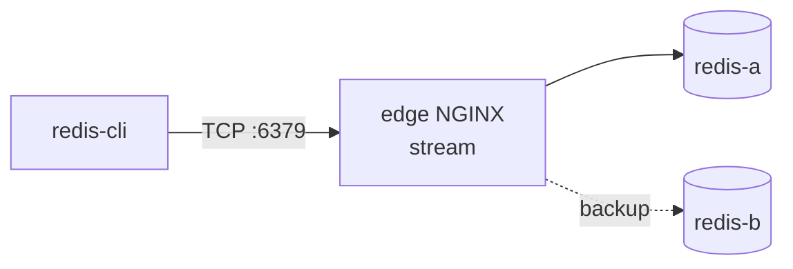

# LAB 08 – TCP/UDP load balancing with `stream`

> **Story:** PixelShop keeps sessions in Redis. The ops team added a second Redis node and wants a single, stable endpoint – with automatic failover. NGINX can proxy any TCP or UDP protocol, not just HTTP.

| | |
|---|---|
| **Duration** | ~25 min |
| **You edit** | `env/nginx/stream.d/*.conf` (included in the `stream {}` context of `nginx.conf`) |
| **Solution** | `solutions/LAB08/` (or `./bin/ngx catchup 8`) |



`stream {}` is a separate world from `http {}`: no `location`, no headers, no `proxy_set_header` – NGINX only sees bytes and connections.

## Step 1 – Round robin over TCP

1. Look at `env/nginx/nginx.conf` – find the `stream {}` block and its `include`.
2. `env/nginx/stream.d/00-resolver.conf` – the stream context does **not** inherit anything from `http {}`:

   ```nginx
   resolver 127.0.0.11 valid=10s ipv6=off;
   ```

3. `env/nginx/stream.d/10-redis.conf`:

   ```nginx
   upstream redis_pool {
       zone redis_pool 64k;
       server redis-a:6379 resolve;
       server redis-b:6379 resolve;
   }

   server {
       listen 6379;
       proxy_pass            redis_pool;
       proxy_connect_timeout 2s;
       proxy_timeout         10m;
   }
   ```

4. Test with a throw-away redis-cli container:

   ```bash
   ./bin/ngx reload
   alias rcli='docker run --rm --network host redis:7-alpine redis-cli -h 127.0.0.1 -p 6379'
   for i in 1 2 3 4; do rcli info server | grep run_id; done
   ```

   ✅ **Checkpoint:** two different `run_id`s alternate – every new TCP connection goes to the next node.

## Step 2 – Why round robin is wrong for a database

```bash
rcli set course nginx
for i in 1 2 3 4; do rcli get course; done
```

Half of the answers are empty! The two Redis nodes do not replicate. **A load balancer does not make a stateful service consistent** – for writes you need one primary.

## Step 3 – Active / passive

Change redis-b to a backup:

```nginx
    server redis-b:6379 resolve backup;
```

```bash
./bin/ngx reload
rcli set course nginx
for i in 1 2 3; do rcli get course; done          # always "nginx" (redis-a)
docker compose -f env/docker-compose.yml stop redis-a
rcli get course                                   # empty - served by redis-b
docker compose -f env/docker-compose.yml start redis-a
```

✅ **Checkpoint:** traffic fails over to redis-b when redis-a is down and returns after it is back (thanks to `resolve`). Real HA would add replication (e.g. Redis Sentinel) – NGINX handles the *routing*.

## Step 4 (bonus) – UDP: DNS

`env/nginx/stream.d/20-dns.conf`:

```nginx
server {
    listen 5353 udp;
    proxy_pass      127.0.0.11:53;     # Docker's DNS inside the edge container
    proxy_responses 1;                 # one reply per request - frees the session immediately
    proxy_timeout   2s;
}
```

```bash
./bin/ngx reload
dig @127.0.0.1 -p 5353 api-1 +short       # or: docker run --rm --network host alpine/bind-tools dig ...
```

✅ **Checkpoint:** the container IP of `api-1` – resolved through NGINX over UDP.

## Discussion

- `ssl_preread` lets NGINX route TLS connections **by SNI without decrypting** them – e.g. many HTTPS backends behind one port 443.
- `proxy_protocol on;` passes the original client IP to backends that understand the PROXY protocol (HAProxy, NGINX, many ingress controllers).
- Which metrics do you lose at L4 compared with L7?

## Troubleshooting

| Symptom | Likely cause |
|---|---|
| `"server" directive is not allowed here` | stream config was placed in `conf.d/` (http context) instead of `stream.d/` |
| `host not found in upstream` | missing `resolve` / resolver in the stream context, container down |
| `Could not connect to Redis` | port 6379 is already used on the host |
